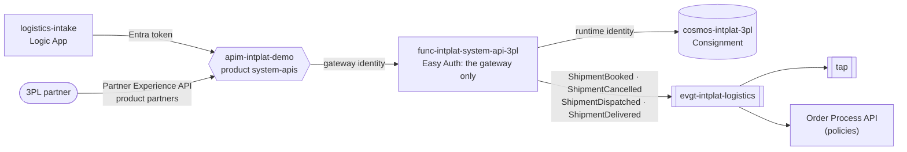
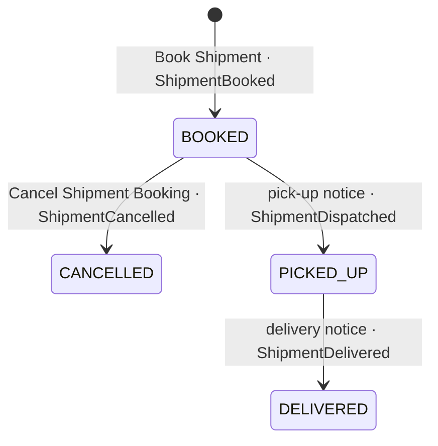

# system-api-3pl

The **[Logistics] Logistics Partner System API**: the simulated 3PL of the logistics domain, in the platform's contract. Owned by
the **logistics team**. A Python Function on Flex Consumption.

| File | What |
|---|---|
| [`openapi.yaml`](openapi.yaml) | The REST contract (internal: product `system-apis`) |
| [`asyncapi.yaml`](asyncapi.yaml) | The logistics facts it publishes on `evgt-intplat-logistics` |
| [`tpl.py`](tpl.py) | 3PL's own model and rules, and the mapping to the contract |
| [`function_app.py`](function_app.py) | The routes |
| [`kit.py`](kit.py) | Platform plumbing, the same in every System API: responses, journey, contract validation, Cosmos DB, facts |
| [`infra/`](infra/) | Function (Flex Consumption), storage, Easy Auth |

## Where it sits

| Operation | | Notes |
|---|---|---|
| Book Shipment | `POST /shipment-bookings` | Strict: exactly the fields of the partner's API 2.3, else 400. One per order: ShipmentBooked |
| Retrieve List of Shipment Bookings | `GET /shipment-bookings?status=booked` | The partner's work list |
| Retrieve Shipment Booking | `GET /shipment-bookings/{shipmentId}` |  |
| Cancel Shipment Booking | `DELETE /shipment-bookings/{shipmentId}?reason=` | Until picked up (else 409): ShipmentCancelled |
| Record Pick Up | `POST /shipment-bookings/{shipmentId}/pick-up` | The partner's pick-up notice: ShipmentDispatched |
| Retrieve Shipment | `GET /shipments/{shipmentId}` | A consignment the partner picked up |
| Record Delivery | `POST /shipments/{shipmentId}/delivery` | The partner's delivery notice: ShipmentDelivered |
| Request Shipment | `POST /shipments` | **Deprecated** since 1.1.0 (book instead): picked up at once |

Since 1.1.0 a consignment is booked first, and the partner reports the pick-up itself (through the
[Partner Experience API](https://github.com/azure-intelligence-domain/experience-api-partner)), so an
order can still be cancelled while it waits for the truck (ADR 0018). Nothing is removed: the old
one-step `POST /shipments` still works, marked deprecated (adidas: never break a contract).

Every write is idempotent per order where the contract says so: a retry returns what exists and
publishes nothing, so Event Grid's at-least-once delivery never creates a second sales order,
reservation or shipment.

The partner's shipment API is **strict**: `shipmentRequest` has `additionalProperties: false`, so a request
with any field the partner's API 2.3 does not know is refused with `400`. That is where the v2.4 story
breaks (step 8): a new mapping in `logistics-intake` sends a field the partner does not take.

## The contract and 3PL

3PL keeps its own model ([backend-systems/3pl](https://github.com/azure-intelligence-domain/backend-systems/tree/main/3pl)); this API
translates. A System API translates and keeps the system's own rules; it does not decide for the
order domain.

| Contract | 3PL |
|---|---|
| `shipmentId` | Consignment.id (SPD-<orderId>) |
| `orderId` | customerRef |
| `deliveryAddress` | shipToStreet, shipToZip, shipToCity, shipToCountry |
| `orderLines[]` | items: sku, qty |
| `status` (shipment) | state: PICKED_UP → dispatched, DELIVERED → delivered |
| `status` (booking) | state: BOOKED → booked, PICKED_UP/DELIVERED → pickedUp, CANCELLED → cancelled |
| `requestedDeliveryDate` | wantedBy |

## Tests

`uv run --no-project --python 3.12 --with-requirements requirements.txt --with pytest pytest -q`:
the logic against an in-memory database, every operation is a function, and every published
event matches `asyncapi.yaml` and the envelope.

## Pipeline

`.github/workflows/deploy.yml`: contract check and tests, then on `main`: Bicep, code, and two
smoke tests (the Function refuses calls that skip the gateway; the gateway refuses callers without
a platform token). Ends with a deployment event.
